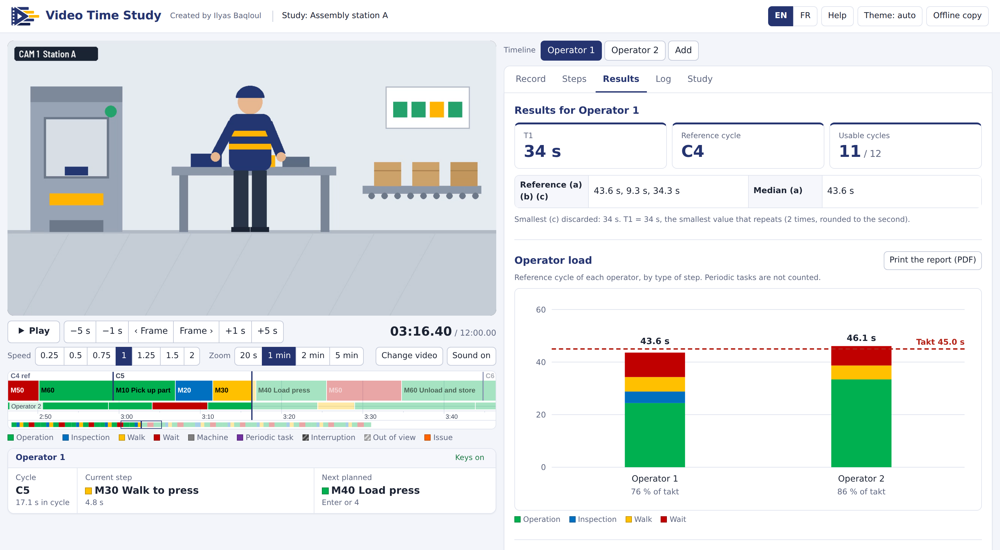

# Video Time Study

Free time study tool that works on a video, right in your browser.
Play the video and press one key each time a new step starts. The tool does the rest.

It is made for methods, industrial and continuous improvement engineers who time operators from a video.

**Open the tool: https://vts-tool.com**

In other languages: [Français](https://vts-tool.com/fr/), [Deutsch](https://vts-tool.com/de/), [Español](https://vts-tool.com/es/), [Čeština](https://vts-tool.com/cs/), [Italiano](https://vts-tool.com/it/), [Polski](https://vts-tool.com/pl/), [Português](https://vts-tool.com/pt/)

User guide (English, section by section): https://vts-tool.com/guide/

## What you get

- Cycle times for every cycle: (a) cycle time, (b) waiting time, (c) work content
- T1 and the reference cycle: lowest repeatable time by default (standardized work), or the median or the mean; to the tenth of a second for short cycles; the first 20 usable cycles are used everywhere (10 are needed)
- The precision of the study (95 %) and the number of cycles to reach ± 5 %
- Periodic tasks (a box to change, a bin to empty) with how often they come back, also the ones the video does not show: they count in the cycle, the load, the balancing and the sheets
- Parts per cycle and output (parts per hour)
- Statistics for each step, and the load of each operator (time per part) against the takt time
- A PDF report with the verdict, the method, the load chart and the cycles of each operator
- A full Excel workbook for any company: summary, times of each operator, standardized work combination table, line balancing, layout (the walking of every state and the plans) and how the figures are worked out
- Your own standard sheets filled in, if you use these templates: Time Measurement Sheet, TCT (Standardized Work) with the layout sheets, and Work Cell Balancing, one sheet per operator, formulas and macros kept
- CSV exports, a copy for Excel, and a study file you can save and open again
- Line balancing (Yamazumi): the steps of each operator stacked against the takt, scenarios where you move steps from one operator to another, with the gains shown and the steps given to another operator marked, kaizen actions
- Layout and walking paths: a picture of your plan, a PDF or your AutoCAD drawing (DXF) at scale, faded as much as you like, machines cut out of it or taken from its blocks, turned to any angle, each step placed where the operator stands, then scenarios compared with today's layout (distance, steps, walking time), with the operators shown walking; an A3 PDF presentation to show on the shop floor
- Layout linked to the balancing: a layout scenario takes the split of a balancing scenario, and the walks of that scenario take the times of the plan
- Plans as a picture, a PDF (kept sharp when you zoom in) or an AutoCAD drawing (DXF), through one button; each step placed by clicking the spot where the operator stands
- The station of each step, typed in Steps or pasted from Excel: the layout places the stations by name and each question goes straight to the station of its step; you still click where exactly the operator arrives and the way they walk there
- A new scenario starts from the current state or from any scenario, with its balancing and its layout
- Compare / Reports: the scenarios side by side against the current state or another scenario, then one PDF report on the layout, the line balancing or both
- Excel for a scenario (simulation): a Simulation sheet in the workbook, the TCT and Work Cell Balancing filled for that scenario
- iPhone videos (HEVC) that a browser cannot read are converted in the browser to 720p at 30 frames a second, nothing is uploaded

You can follow several operators and machines on the same video. The tool is in English, French, German, Spanish, Czech, Italian, Polish and Portuguese, and works on a computer or a phone. On a phone, you can film the workstation straight from the site.

Not sure where to start? Press **Try an example**: a fictional line with two operators and a press, already timed, with a balancing scenario and its layout.

## How it works

1. Choose the video, or film it with the phone. It stays on your device; a video filmed or converted on the site is kept in your browser until you save it.
2. In Steps, list the steps of the cycle in order, with their type: Operation, Inspection, Walk or Wait, and if you like the station where each one is done.
3. Play the video. When a step starts, press its key, or Enter for the next step of the list.
4. Mark what is not normal work: F for an issue and I for an interruption (those cycles are left out of T1), P for a periodic task (its time is shared out over the parts with its frequency).
5. Read the results, download the PDF report and the Excel workbook, try a balancing scenario and its layout.

## Keys

| Key | Action |
|---|---|
| Space | Play or pause |
| Left / Right | Back or forward 1 s (with Shift: 5 s) |
| , and . | Previous or next frame |
| [ and ] | Slower or faster |
| Enter | Record the next step of the list |
| 1 to 9, 0, then letters | Record that step (its key is shown on the step) |
| F | Issue on the current step |
| I | Interruption |
| P | Periodic task |
| V | Out of view |
| W | Walk not in the list |
| A | Wait not in the list |
| X | End of study |
| Delete (twice) | Delete the step in progress |
| Ctrl+Z / Ctrl+Y | Undo / Redo |
| ? | Help |

## Privacy

No account and nothing to install. The video and your data never leave your computer: everything runs in the browser. Your study is kept in this browser; save a study file to keep it or send it. Visits to the site are counted with GoatCounter, without cookies and without keeping IP addresses.

You can also download an offline copy of the tool (one HTML file) that works without internet.

## License

Copyright (c) 2026 Ilyas Baqloul. All rights reserved.

You can use Video Time Study for free, including at work, and give the offline copy to other people without changing it. You may not reuse or modify the code, put a copy online or sell it without permission. See [LICENSE](LICENSE).

## Author

Made by Ilyas Baqloul, engineering student at ENIM (manufacturing processes).
Feedback is welcome: open an issue here or send me a message on LinkedIn.
