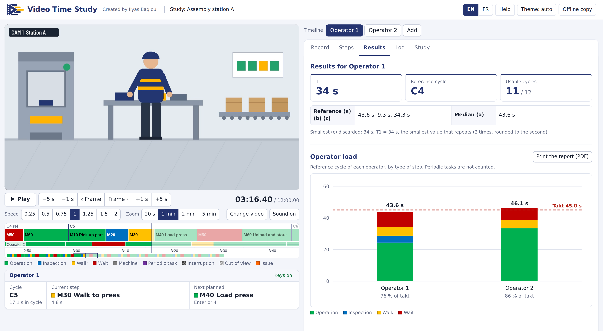

# Video Time Study

Free time study tool that works on a video, right in your browser.
Play the video and press one key each time a new step starts. The tool does the rest.

It is made for methods, industrial and continuous improvement engineers who time operators from a video.

**Open the tool: https://ilyas-baqloul.github.io/Video-Time-Study/**

## What you get

- Cycle times for every cycle: (a) cycle time, (b) waiting time, (c) work content
- T1 and the reference cycle, with the usable cycles counted for you (10 are needed)
- Statistics for each step
- The load of each operator against the takt time
- A printed report (save it as PDF)
- Your Excel standard sheets filled in: Time Measurement Sheet and TCT (Standardized Work), one sheet per operator, formulas and macros kept. It works with the template layouts it was built for.
- CSV exports, a copy for Excel, and a study file you can save and open again

You can follow several operators and machines on the same video. The tool is in English and French and works on a computer or a phone.

## How it works

1. Choose the video. It stays on your computer.
2. In Steps, list the steps of the cycle in order, with their type: Operation, Inspection, Walk or Wait.
3. Play the video. When a step starts, press its key, or Enter for the next step of the list.
4. Mark the problems: F for an issue, I for an interruption, P for a periodic task. Those cycles are left out of the results.
5. Read the results, print the report or download the filled sheets.

## Keys

| Key | Action |
|---|---|
| Space | Play or pause |
| Left / Right | Back or forward 1 s (with Shift: 5 s) |
| , and . | Previous or next frame |
| [ and ] | Slower or faster |
| Enter | Record the next step of the list |
| 1 to 9, 0, then letters | Record that step (its key is shown on the step) |
| F | Issue on the current step |
| I | Interruption |
| P | Periodic task |
| V | Out of view |
| W | Walk not in the list |
| A | Wait not in the list |
| X | End of study |
| Delete (twice) | Delete the step in progress |
| Ctrl+Z / Ctrl+Y | Undo / Redo |
| ? | Help |

## Privacy

No account and nothing to install. The video and your data never leave your computer: everything runs in the browser and nothing is uploaded. Your study is kept in this browser; save a study file to keep it or send it.

You can also download an offline copy of the tool (one HTML file) that works without internet.

## License

Copyright (c) 2026 Ilyas Baqloul. All rights reserved.

You can use Video Time Study for free, including at work, and give the offline copy to other people without changing it. You may not reuse or modify the code, put a copy online or sell it without permission. See [LICENSE](LICENSE).

## Author

Made by Ilyas Baqloul, engineering student at ENIM (manufacturing processes).
Feedback is welcome: open an issue here or send me a message on LinkedIn.
